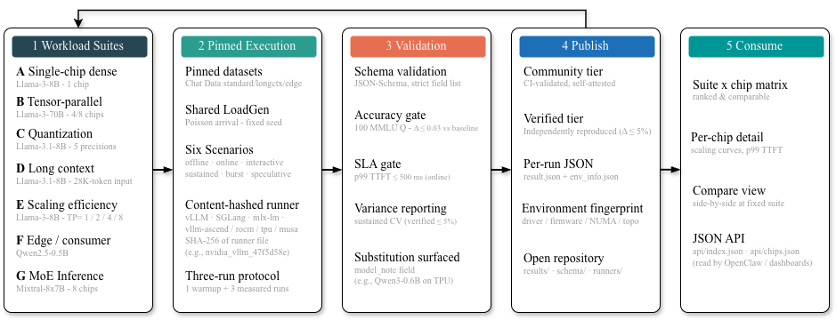
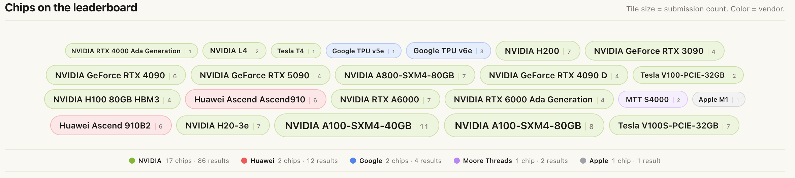

<p align="center">
  <picture>
    <source media="(prefers-color-scheme: dark)" srcset="docs/assets/logo-wordmark-dark.svg">
    
  </picture>
</p>

<p align="center">
  <strong>Open, community-driven LLM inference leaderboard for every AI accelerator.</strong><br>
  <sub>Real-world speed, latency, and cost-efficiency across NVIDIA, AMD, Huawei Ascend, Apple Silicon, Google TPU &amp; Moore Threads — no SOTA tuning required.</sub>
</p>

<p align="center">
  <a href="https://freedomintelligence.github.io/AccelMark"></a>
  <a href="https://github.com/FreedomIntelligence/AccelMark/actions/workflows/validate_pr.yml"></a>
  <a href="https://github.com/FreedomIntelligence/AccelMark/actions/workflows/generate_leaderboard.yml"></a>
  <a href="LICENSE"></a>
  <a href="CONTRIBUTING.md"></a>
</p>

<p align="center">
  <a href="https://freedomintelligence.github.io/AccelMark"><strong>→ Live Leaderboard</strong></a> ·
  <a href="CONTRIBUTING.md">Contributing</a> ·
  <a href="suites/README.md">Suites</a> ·
  <a href="https://github.com/FreedomIntelligence/AccelMark/discussions">Discussions</a> ·
  <a href="https://freedomintelligence.github.io/AccelMark/#/agent">Agent Track</a> ·
  <a href="https://freedomintelligence.github.io/AccelMark/#/wanted">Wanted Hardware</a> ·
  <a href="DEVELOPMENT.md">Development</a>
</p>

<p align="center">
  
</p>

<p align="center">
  <em>From workload spec to published result — every row on the leaderboard carries its runner hash, environment fingerprint, and accuracy receipt.</em>
</p>

---

## Why AccelMark?

| | The problem | AccelMark's answer |
|---|---|---|
| **MLPerf** | Rigorous but slow — only large vendors participate | Community runs often finish quickly (e.g. Suite A default ~11 min; Suite D default ~22 min; full all-scenarios run ~7 h) |
| **Vendor whitepapers** | Different setups make cross-vendor comparison impossible | Fixed schema + shared LoadGen = apples-to-apples |
| **Most benchmarks** | Cover only NVIDIA and only throughput | NVIDIA, AMD, Huawei Ascend, Apple Silicon — throughput, latency, scaling, quantization |

---

## 3 Ways to Participate

1. **Got a GPU/NPU? Submit a real-world baseline (~10 min)** — Out-of-the-box default numbers on consumer, older, or domestic chips are *just as valuable* as tuned SOTA runs.
2. **Verify someone else's run** — Pick an open [Reproduction Quest](https://freedomintelligence.github.io/AccelMark/#/reproduce) to promote a `community` result to `verified`.
3. **No GPU? Query & contribute** — Compare chips/cost-efficiency locally with `python tools/advisor.py --compare "4090" "3090"`, use our [Agent Skill](.claude/skills/accelmark/SKILL.md), or [request a hardware benchmark](https://github.com/FreedomIntelligence/AccelMark/issues/new?template=hardware_request.md).

---

## Quick start

```bash
# 1. Clone and install
git clone https://github.com/FreedomIntelligence/AccelMark.git
cd AccelMark
pip install "jsonschema>=4.0" "numpy>=1.24" "pyyaml>=6.0"       # framework dependencies (Python >=3.10 required)
pip install -r runners/nvidia_vllm_47f5d58e/requirements.txt # installs runner dependencies

# 2. One-time setup & 10-second pre-flight check (no model download)
python run.py --init

# 3. Run the fastest suite (~10 min on consumer GPU) or Suite A (~11 min on A100)
#    --runner auto picks the default runner for your hardware (or use aliases: vllm, sglang, ascend, mlx, rocm, tpu, musa)
python run.py --runner auto --suite suite_F

# 4. Validate, preview your projected rank, and get exact PR / zip upload steps:
python run.py --submit results/community/<run_name>
#    (Add --zip if you prefer uploading via a GitHub Issue instead of git/PR)
```

See [CONTRIBUTING.md](CONTRIBUTING.md) for the full guide.

---

## Suites

| Suite | Model | Chips | Question answered | Primary metric |
|-------|-------|-------|-------------------|----------------|
| **A** (Single-chip chat) | Llama-3-8B | 1 | How fast is this chip at inference? | Offline tokens/sec |
| **B** (Large model TP) | Llama-3-70B | flexible | Can this chip serve large models? | Offline tokens/sec |
| **C** (Quantization) | Llama-3.1-8B | 1 | Quantization speed/quality tradeoff? | Speedup vs BF16 |
| **D** (28K long context) | Llama-3.1-8B | 1 | How does this chip handle long-context (28K) inputs? | Offline tokens/sec |
| **E** (Multi-GPU scaling) | Llama-3-8B | 1×/2×/4×/8× | How well does this chip scale? | Scaling efficiency |
| **F** (Consumer / quick 10m) | Qwen2.5-0.5B | 1 | How fast is this consumer/edge GPU? | Offline tokens/sec |
| **G** (Sparse MoE) | Mixtral-8x7B-Instruct | ≥2 (auto) | How efficiently does this chip handle sparse MoE inference? | Offline tokens/sec |
| **H** (Sliding-window SWA) | Mistral-7B-Instruct | 1 | How well does this chip handle sliding-window attention (10K ctx, 4K window)? | Offline tokens/sec |

Suites A, B, and D also include optional **speculative decoding** and/or **burst load** extra scenarios — see [suites/README.md](suites/README.md) for per-suite details.

See [suites/README.md](suites/README.md) for full specs, time budgets, SLA definitions, and metric descriptions.

---

## Currently on the leaderboard

<p align="center">
  
</p>

A snapshot of accelerators that have at least one submission on the leaderboard. Tile size is proportional to submission count; colour denotes vendor. See the [**live leaderboard**](https://freedomintelligence.github.io/AccelMark) for current rankings, per-suite breakdowns, and the underlying `result.json` files.

---

## Supported platforms

Reference runners live under `runners/` (see each folder’s `meta.json`). The table below is **auto-generated** from each runner's `meta.json` — never hand-edited. Add a runner, declare its `suite_support` in `meta.json`, and the matrix updates on its own.

<!-- platforms-matrix:start -->
| Hardware | Runner folder | Framework | A | B | C | D | E | F | G | H |
|---|---|---|:-:|:-:|:-:|:-:|:-:|:-:|:-:|:-:|
| NVIDIA GPU | `nvidia_sglang_c43a8309` | SGLang | ✓ | ✓ | ✓ | ✓ | ✓ | ✓ | ✓ | ⋯ |
| NVIDIA GPU | `nvidia_tensorrt_llm_21323970` | TensorRT-LLM | ✓ | ⋯ | ✓ | — | ⋯ | ✓ | ⋯ | ⋯ |
| NVIDIA GPU | `nvidia_vllm_47f5d58e` | vLLM | ✓ | ✓ | ✓ | ✓ | ✓ | ✓ | ✓ | ✓ |
| AMD GPU | `amd_vllm_rocm_6c18cd8f` | vLLM-ROCm | ✓ | ✓ | ✓ | ✓ | ✓ | ✓ | ✓ | ? |
| Huawei Ascend NPU | `ascend_vllm_ascend_b1957851` | vllm-ascend | ✓ | ✓ | ✓ | ✓ | ✓ | — | — | ? |
| Huawei Ascend NPU | `ascend_vllm_ascend_d4aa9fda` | vllm-ascend | ✓ | ✓ | ✓ | ✓ | ✓ | — | — | ? |
| Apple Silicon | `apple_mlx_lm_9546b8b5` | mlx-lm | ⋯ | — | — | ⋯ | — | ⋯ | — | ? |
| Google TPU | `google_vllm_tpu_68cc9ffa` | vllm-tpu | ✓ | — | — | ✓ | — | ✓ | — | ? |
| Moore Threads GPU | `moorethreads_vllm_musa_6607740b` | vllm-musa | ✓ | ✓ | ⋯ | ⋯ | ✓ | ✓ | — | ? |
| Moore Threads GPU | `moorethreads_vllm_musa_f2f6f965` | vllm-musa | ✓ | ⋯ | ⋯ | ⋯ | ⋯ | ✓ | — | ? |
| Iluvatar CoreX GPU | `iluvatar_vllm_ixuca_4d3befc9` | vllm-ixuca | ⋯ | ⋯ | ⋯ | ⋯ | ⋯ | ✓ | ⋯ | ✓ |

<details><summary>Optimized &amp; experimental runners (4)</summary>

| Hardware | Runner folder | Framework | A | B | C | D | E | F | G | H |
|---|---|---|:-:|:-:|:-:|:-:|:-:|:-:|:-:|:-:|
| NVIDIA A100-SXM4-80GB | `nvidia_sglang_inference_opt_4fd1e59e` | SGLang | ⋯ | ⋯ | ⋯ | ⋯ | ⋯ | ✓ | ⋯ | ? |
| NVIDIA A100-SXM4-80GB | `nvidia_sglang_inference_opt_5fe06410` | SGLang | ⋯ | ⋯ | ⋯ | ⋯ | ⋯ | ✓ | ⋯ | ? |
| NVIDIA GPU | `nvidia_vllm020_0f6c56e4` | vLLM | ⋯ | ⋯ | ⋯ | ⋯ | ⋯ | ⋯ | ⋯ | ? |
| NVIDIA V100 (SM70) | `nvidia_onecat_vllm_12a253c2` | 1Cat-vLLM | ⋯ | ⋯ | ⋯ | ⋯ | ⋯ | — | ⋯ | ? |

</details>

_Legend: ✓ validated · ⋯ author-declared (not smoke-tested in this repo yet) · — unsupported._
<!-- platforms-matrix:end -->

> Maintainers regenerate this matrix with `python tools/generate_platforms_matrix.py` — contributor PRs do not need to edit `README.md`.

Other stacks (TensorRT-LLM, MindIE, mlx-lm, etc.) can be added as new runner folders; see the contributor guide.

Adding a new runner? See [CONTRIBUTING.md#adding-a-new-runner](CONTRIBUTING.md#adding-a-new-runner). Adding a new accelerator family? See [`runners/README.md`](runners/README.md#adding-a-new-accelerator-family).

---

## Open JSON API & Zero-GPU Advisor

Every merge to `main` automatically publishes static, auth-free JSON endpoints on GitHub Pages for scripts, dashboards, and AI agents:

| Endpoint | Contents |
|---|---|
| `https://freedomintelligence.github.io/AccelMark/api/chips.json` | Indexed accelerators, submission counts, best & median throughput |
| `https://freedomintelligence.github.io/AccelMark/api/rank.json` | Per-submission suite ranks, framework, runner tier, and primary metric |
| `https://freedomintelligence.github.io/AccelMark/api/index.json` | Per-chip suite breakdown for fast programmatic lookup |
| `https://freedomintelligence.github.io/AccelMark/api/suites.json` | Suite specifications, models, and SLA parameters |

Query the leaderboard locally (no GPU required) with `tools/advisor.py`:

```bash
# Find the best Tok/$ options under $2.00/hr using out-of-the-box reference runners
python tools/advisor.py --suite suite_A --budget 2.0 --tier reference

# Compare frameworks (vLLM vs SGLang vs TensorRT-LLM) on the same chip
python tools/advisor.py --engine-compare "A100"

# Export a Markdown or JSON comparison table for docs / agents
python tools/advisor.py --compare "4090" "3090" "A100" --format markdown
```

---

## Leaderboard tiers

| Tier | How | Where |
|------|-----|-------|
| **community** | Submitted by anyone via PR and passes CI validation | Community tab |
| **verified** | Independently reproduced on the same hardware/runner and matches the original within 5% | Main leaderboard |

Community results are fully visible and comparable — they just haven't been independently reproduced yet. Anyone with the listed hardware can promote a community result to verified by submitting a reproduction PR.

---

## Contributing

The most valuable contribution is running the benchmark on hardware not yet in the leaderboard.

- **Submit a result** → [Submitting a result](CONTRIBUTING.md#submitting-a-result)
- **Browse wanted hardware & reproduction quests** → [Wanted Hardware](https://freedomintelligence.github.io/AccelMark/#/wanted) · [Reproduce Community Results](https://freedomintelligence.github.io/AccelMark/#/reproduce)
- **Explore inference-optimization agents** → [Agent Optimization Track](https://freedomintelligence.github.io/AccelMark/#/agent)
- **Add a new runner** → [Adding a new runner](CONTRIBUTING.md#adding-a-new-runner)
- **Add a new accelerator family** → [Platform plug-in guide](runners/README.md#adding-a-new-accelerator-family)
- **Report a bug** → [Open an issue](https://github.com/FreedomIntelligence/AccelMark/issues/new?template=bug_report.md)
- **Ask a question / share results** → [Discussions](https://github.com/FreedomIntelligence/AccelMark/discussions)
- **Extend the leaderboard** → [Development guide](DEVELOPMENT.md)

> _Optional:_ AccelMark also ships a small voice-driven launcher for the [OpenClaw](https://clawhub.ai) ecosystem — see [`openclaw_skill/`](openclaw_skill/README.md). It's not required to run, contribute, or submit results.

---

## Citation

If you use AccelMark results in research, please cite:

```bibtex
@misc{accelmark2026,
  title  = {Beyond NVIDIA! A  Multi-Regime Framework for Benchmarking Heterogeneous AI Accelerators},
  author = {Liang, Juhao and Zhang, Zhiyuan and Li, Siyu and Lin, Zhihang and Yu, Minchen and Zeng, Li and Chen, Zizhong and Sun, Ruoyu and Wang, Benyou},
  year   = {2026},
  url    = {https://github.com/FreedomIntelligence/AccelMark}
}
```

---

## License

Apache 2.0 — see [LICENSE](LICENSE).
Submitted benchmark results are contributed under [CC BY 4.0](https://creativecommons.org/licenses/by/4.0/).
Bundled third-party data (datasets, accuracy subsets) keeps its upstream license — see [NOTICE](NOTICE).