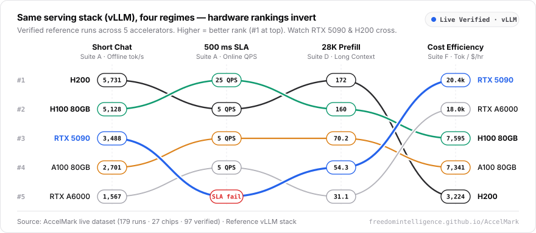
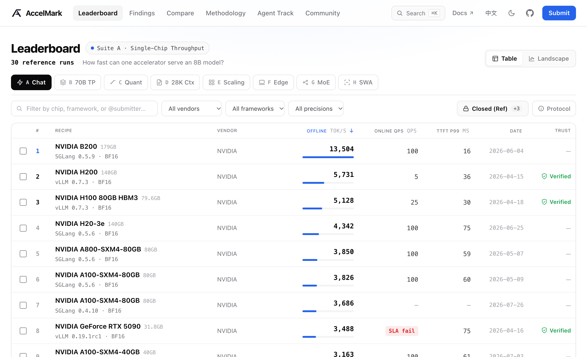
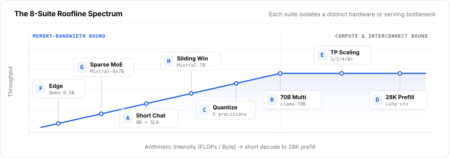

<p align="center">
  <picture>
    <source media="(prefers-color-scheme: dark)" srcset="docs/assets/logo-wordmark-dark.svg">
    
  </picture>
</p>

<h3 align="center">No single fastest chip — only the best serving recipe for your workload.</h3>

<p align="center">
  Open, reproducible LLM inference benchmarks across <strong>NVIDIA, AMD, Huawei Ascend, Apple Silicon, Google TPU, Moore Threads &amp; Iluvatar CoreX</strong>.
</p>

<p align="center">
  <a href="https://freedomintelligence.github.io/AccelMark"></a>
  <a href="https://freedomintelligence.github.io/AccelMark/docs/"></a>
  <a href="#citation"></a>
  <a href="LICENSE"></a>
  <a href="https://github.com/FreedomIntelligence/AccelMark/discussions"></a>
</p>

<p align="center">
  <a href="https://freedomintelligence.github.io/AccelMark"><strong>Live Leaderboard</strong></a> ·
  <a href="https://freedomintelligence.github.io/AccelMark/docs/"><strong>Documentation</strong></a> ·
  <a href="https://freedomintelligence.github.io/AccelMark/#/findings"><strong>Key Findings</strong></a> ·
  <a href="https://freedomintelligence.github.io/AccelMark/#/submit"><strong>Submit in 10 min</strong></a> ·
  <a href="README.zh-CN.md"><strong>简体中文</strong></a>
</p>

<p align="center">
  <picture>
    <source media="(prefers-color-scheme: dark)" srcset="docs/assets/rank-shift-dark.svg">
    
  </picture>
</p>

<p align="center">
  <sub><em>Auto-generated from live verified reference runs (identical vLLM stack). Rankings invert across short chat, 500 ms SLA, 28K prefill, and cost efficiency.</em></sub>
</p>

---

## News

- **2026-11 · v0.2.0** — Added **Iluvatar CoreX** & **Moore Threads** runners, one-command onboarding (`run.py --init` / `--submit`), Closed/Open runner-tier separation, and redesigned leaderboard + MkDocs site.
- **2026-08** — Added **Suite H (Sliding-Window Attention)** and the **Agent Optimization Track** (`#/agent`).
- **2026-05 · v0.1.0** — Initial release with 8 Roofline workload suites, 7 hardware ecosystems, MMLU accuracy gate, and static JSON API.

---

## Why AccelMark?

Vendor datasheets and single-number benchmarks hide the regime reversals that decide real LLM serving cost and latency. AccelMark benchmarks complete, auditable **serving recipes** (`chip × framework × precision × parallelism`) under pinned protocols:

- **Rankings invert across regimes** — On identical vLLM, **RTX 5090** beats **A100-80GB** by **+29%** on short chat (Suite A), then flips and loses by **−23%** on 28K long-context prefill (Suite D).
- **Offline winner ≠ SLA winner** — **H200** leads Suite A offline (**5,731 tok/s**) yet caps at **5 QPS** under the 500 ms p99 TTFT SLA; **H100** sustains **25 QPS (5×)** on the exact same stack.
- **Engine moves more than silicon** — Switching **vLLM → SGLang** on the exact same **H20-3e** lifts throughput by **+89%** (2,298 → 4,342 tok/s).
- **Fastest chip is rarely best value** — On edge Suite F, **Tesla T4** delivers **6.7× more tokens per dollar** than **H100**; in 2× TP scaling (Suite E), **RTX 4090 D** retains **94.5%** efficiency vs **H200**'s **60.2%**.

> Explore all 6 live empirical findings and the workload procurement matrix on [**Key Findings →**](https://freedomintelligence.github.io/AccelMark/#/findings) or [**docs/key-findings.md**](docs/key-findings.md).

---

## Quick Start (~10 Minutes)

> **No SOTA tuning required.** Honest out-of-the-box reference baselines (`Closed` division) on consumer, older, or emerging accelerators are just as valuable as datacenter flagships.

```bash
git clone https://github.com/FreedomIntelligence/AccelMark.git && cd AccelMark
pip install -e . && pip install -r runners/nvidia_vllm_47f5d58e/requirements.txt

python run.py --init                               # 10s handle setup & pre-flight check (no download)
python run.py --runner auto --suite suite_F        # ~10 min on 1 GPU (MMLU accuracy gate runs first)
python run.py --submit results/community/<run>     # validate, preview rank, open PR or pass --zip
```

Running on **AMD, Huawei Ascend, Apple Silicon, Google TPU, Moore Threads, or Iluvatar** — or behind a mainland China mirror? Use the [**interactive command builder →**](https://freedomintelligence.github.io/AccelMark/#/submit) or [**Installation Guide →**](https://freedomintelligence.github.io/AccelMark/docs/getting-started/install/).

---

## Leaderboard Preview

<p align="center">
  <a href="https://freedomintelligence.github.io/AccelMark/#/rankings">
    <picture>
      <source media="(prefers-color-scheme: dark)" srcset="docs/assets/leaderboard-preview-dark.png">
      
    </picture>
  </a>
</p>

Every row is backed by a **content-hashed runner** (`{platform}_{name}_{hash8}`), an automatic **MMLU accuracy gate** on the exact loaded model, deterministic **`run_id` CI verification**, **Closed (reference) vs Open** separation, and optional **±5% independent reproduction** (`community` → `verified`).

---

## 8 Workload Suites at a Glance

<p align="center">
  <picture>
    <source media="(prefers-color-scheme: dark)" srcset="docs/assets/roofline-suites-dark.svg">
    
  </picture>
</p>

| Suite | Workload | Bottleneck Isolated | Primary Metric | Ref Time (A100) |
|---|---|---|---|---|
| [**A** · Short Chat](https://freedomintelligence.github.io/AccelMark/#/rankings?suite=suite_A) | Llama-3-8B (1 chip) | Memory-BW decode & 500 ms SLA | Offline tok/s · Max QPS | ~11 min |
| [**B** · 70B Multi-Chip](https://freedomintelligence.github.io/AccelMark/#/rankings?suite=suite_B) | Llama-3-70B (4–8 chips) | VRAM capacity & multi-chip TP | Offline tok/s | ~20 min |
| [**C** · Quantization](https://freedomintelligence.github.io/AccelMark/#/rankings?suite=suite_C) | Llama-3.1-8B (5 prec.) | Native low-precision vs MMLU | Quality efficiency | ~22 min |
| [**D** · 28K Prefill](https://freedomintelligence.github.io/AccelMark/#/rankings?suite=suite_D) | Llama-3.1-8B (28K ctx) | Compute-bound prefill | Offline tok/s | ~22 min |
| [**E** · TP Scaling](https://freedomintelligence.github.io/AccelMark/#/rankings?suite=suite_E) | Llama-3-8B (1/2/4/8×) | Interconnect Amdahl overhead | 2× / 4× scaling eff. | ~9 min |
| [**F** · Edge & Consumer](https://freedomintelligence.github.io/AccelMark/#/rankings?suite=suite_F) | Qwen2.5-0.5B (1 chip) | Single-die BW & tok/$/hr | Offline tok/s · tok/$ | ~10 min |
| [**G** · Sparse MoE](https://freedomintelligence.github.io/AccelMark/#/rankings?suite=suite_G) | Mixtral-8x7B (≥2 chips) | Sparse routing & aggregate HBM | Sustained / offline tok/s | ~35 min |
| [**H** · Sliding Window](https://freedomintelligence.github.io/AccelMark/#/rankings?suite=suite_H) | Mistral-7B (10K / 4K) | Windowed KV-cache allocation | Offline tok/s | ~14 min |

---

## Supported Ecosystems & Zero-GPU Tools

| Ecosystem | Reference Stacks | Validated Suites |
|---|---|---|
| **NVIDIA GPU** | vLLM, SGLang, TensorRT-LLM | A–H (8/8) |
| **Iluvatar CoreX GPU** | vllm-ixuca | A–H (8/8) |
| **AMD ROCm GPU** | vLLM-ROCm | A–G (7/8) |
| **Huawei Ascend NPU** | vllm-ascend | A–E (5/8) |
| **Moore Threads GPU** | vllm-musa | A, B, E, F (4/8) |
| **Google Cloud TPU** | vllm-tpu | A, D, F (3/8) |
| **Apple Silicon** | mlx-lm | A, D, F (community) |

<details>
<summary>Full auto-generated runner matrix (reference, optimized &amp; experimental)</summary>

<!-- platforms-matrix:start -->
| Hardware | Runner folder | Framework | A | B | C | D | E | F | G | H |
|---|---|---|:-:|:-:|:-:|:-:|:-:|:-:|:-:|:-:|
| NVIDIA GPU | `nvidia_llamacpp_7c50deed` | llama.cpp | ✓ | ⋯ | ⋯ | ⋯ | ⋯ | ✓ | ⋯ | ⋯ |
| NVIDIA GPU | `nvidia_lmdeploy_turbomind_31f11557` | LMDeploy | ⋯ | ⋯ | ⋯ | ⋯ | ⋯ | ✓ | ⋯ | ⋯ |
| NVIDIA GPU | `nvidia_sglang_c43a8309` | SGLang | ✓ | ✓ | ✓ | ✓ | ✓ | ✓ | ✓ | ⋯ |
| NVIDIA GPU | `nvidia_tensorrt_llm_21323970` | TensorRT-LLM | ✓ | ⋯ | ✓ | — | ⋯ | ✓ | ⋯ | ⋯ |
| NVIDIA GPU | `nvidia_vllm_47f5d58e` | vLLM | ✓ | ✓ | ✓ | ✓ | ✓ | ✓ | ✓ | ✓ |
| AMD GPU | `amd_vllm_rocm_6c18cd8f` | vLLM-ROCm | ✓ | ✓ | ✓ | ✓ | ✓ | ✓ | ✓ | ? |
| Huawei Ascend NPU | `ascend_vllm_ascend_b1957851` | vllm-ascend | ✓ | ✓ | ✓ | ✓ | ✓ | — | — | ? |
| Huawei Ascend NPU | `ascend_vllm_ascend_d4aa9fda` | vllm-ascend | ✓ | ✓ | ✓ | ✓ | ✓ | — | — | ? |
| Apple Silicon | `apple_mlx_lm_9546b8b5` | mlx-lm | ⋯ | — | — | ⋯ | — | ⋯ | — | ? |
| Google TPU | `google_vllm_tpu_68cc9ffa` | vllm-tpu | ✓ | — | — | ✓ | — | ✓ | — | ? |
| Moore Threads GPU | `moorethreads_vllm_musa_6607740b` | vllm-musa | ✓ | ✓ | ⋯ | ⋯ | ✓ | ✓ | — | ? |
| Iluvatar CoreX GPU | `iluvatar_vllm_ixuca_4d3befc9` | vllm-ixuca | ✓ | ✓ | ✓ | ✓ | ✓ | ✓ | ✓ | ✓ |

<details><summary>Optimized &amp; experimental runners (4)</summary>

| Hardware | Runner folder | Framework | A | B | C | D | E | F | G | H |
|---|---|---|:-:|:-:|:-:|:-:|:-:|:-:|:-:|:-:|
| NVIDIA A100-SXM4-80GB | `nvidia_sglang_inference_opt_4fd1e59e` | SGLang | ⋯ | ⋯ | ⋯ | ⋯ | ⋯ | ✓ | ⋯ | ? |
| NVIDIA A100-SXM4-80GB | `nvidia_sglang_inference_opt_5fe06410` | SGLang | ⋯ | ⋯ | ⋯ | ⋯ | ⋯ | ✓ | ⋯ | ? |
| NVIDIA GPU | `nvidia_vllm020_0f6c56e4` | vLLM | ⋯ | ⋯ | ⋯ | ⋯ | ⋯ | ⋯ | ⋯ | ? |
| NVIDIA V100 (SM70) | `nvidia_onecat_vllm_12a253c2` | 1Cat-vLLM | ⋯ | ⋯ | ⋯ | ⋯ | ⋯ | — | ⋯ | ? |

</details>

_Legend: ✓ validated · ⋯ author-declared (not smoke-tested in this repo yet) · — unsupported._
<!-- platforms-matrix:end -->

</details>

**No GPU right now?** Query cost-efficiency & engine comparisons locally, or hit the auth-free static JSON API (`api/manifest.json`, `api/index.json`, `api/chips.json`, `api/rank.json`):

```bash
python tools/advisor.py --suite suite_A --budget 2.0 --tier reference
python tools/advisor.py --engine-compare "A100"
```

---

## Contributing & Community

1. **Submit a baseline (~10 min)** — Especially for [**Wanted Hardware**](https://freedomintelligence.github.io/AccelMark/#/wanted) (supports no-git `--zip` upload).
2. **Verify a result** — Reproduce a `community` entry within ±5% on [**Reproduction Quests**](https://freedomintelligence.github.io/AccelMark/#/reproduce).
3. **Add a runner or read docs** — See [**Documentation**](https://freedomintelligence.github.io/AccelMark/docs/), [**CONTRIBUTING.md**](CONTRIBUTING.md), [**FAQ**](docs/faq.md), and the [**Agent Track**](https://freedomintelligence.github.io/AccelMark/#/agent).

---

## Citation & License

```bibtex
@misc{accelmark2026,
  title  = {Beyond NVIDIA! A Multi-Regime Framework for Benchmarking Heterogeneous AI Accelerators},
  author = {Liang, Juhao and Zhang, Zhiyuan and Li, Siyu and Lin, Zhihang and Yu, Minchen and Zeng, Li and Chen, Zizhong and Sun, Ruoyu and Wang, Benyou},
  year   = {2026},
  url    = {https://github.com/FreedomIntelligence/AccelMark}
}
```

Per-run and snapshot-level citations are generated on the [**Cite page**](https://freedomintelligence.github.io/AccelMark/#/citation) and in [CITATION.cff](CITATION.cff).
Code is licensed under **Apache 2.0** ([LICENSE](LICENSE)); benchmark results under **CC BY 4.0**; bundled third-party datasets retain their upstream licenses ([NOTICE](NOTICE)).
