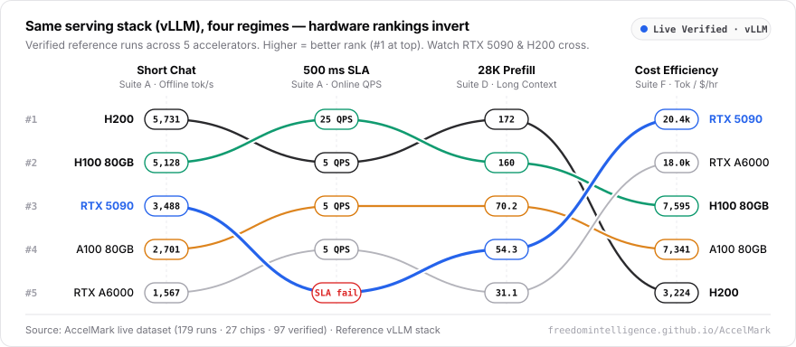
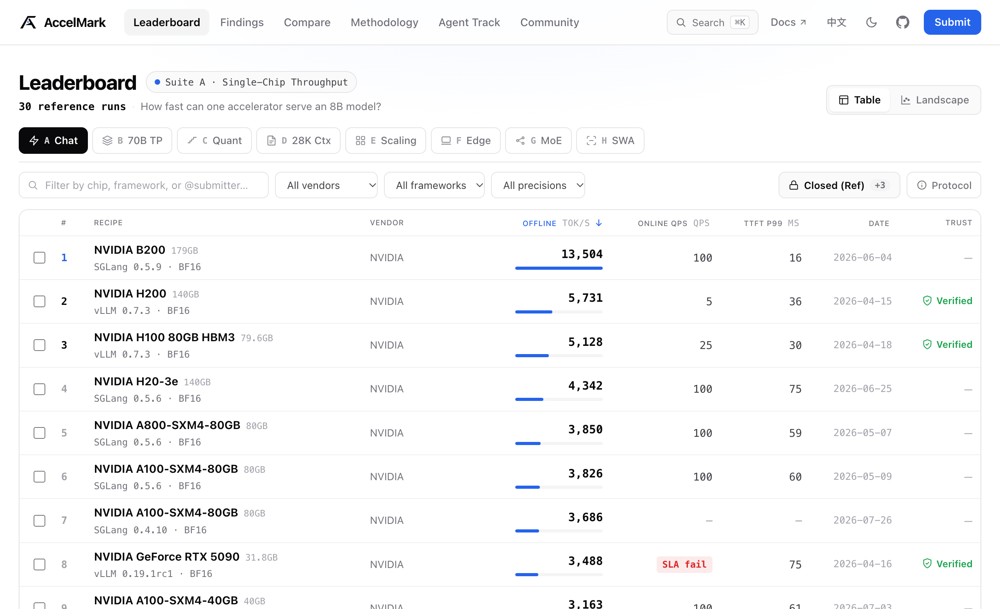
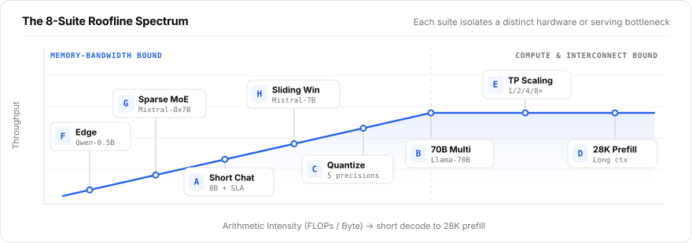

<p align="center">
  <picture>
    <source media="(prefers-color-scheme: dark)" srcset="docs/assets/logo-wordmark-dark.svg">
    
  </picture>
</p>

<h3 align="center">没有唯一的“最快芯片”——只有最适合你负载的推理方案。</h3>

<p align="center">
  <strong>实测验证的 LLM 推理部署方案库</strong>——在 <a href="https://freedomintelligence.github.io/AccelMark"><strong>在线方案榜</strong></a> 按硬件与业务场景找到最优方案，一键隔离装环境并用 <code>--serve</code> 拉起服务。本仓库是驱动它的开放评测与一键服务化基建，覆盖 <strong>NVIDIA、AMD、华为昇腾、Apple Silicon、Google TPU、摩尔线程与天数智芯</strong>。
</p>

<p align="center">
  <a href="https://freedomintelligence.github.io/AccelMark"></a>
  <a href="https://freedomintelligence.github.io/AccelMark/docs/"></a>
  <a href="#引用与协议"></a>
  <a href="LICENSE"></a>
  <a href="https://github.com/FreedomIntelligence/AccelMark/discussions"></a>
</p>

<p align="center">
  <a href="https://freedomintelligence.github.io/AccelMark"><strong>在线排行榜</strong></a> ·
  <a href="https://freedomintelligence.github.io/AccelMark/docs/"><strong>完整文档</strong></a> ·
  <a href="https://freedomintelligence.github.io/AccelMark/#/findings"><strong>核心实证发现</strong></a> ·
  <a href="https://freedomintelligence.github.io/AccelMark/#/submit"><strong>10 分钟提交</strong></a> ·
  <a href="README.md"><strong>English</strong></a>
</p>

<p align="center">
  <picture>
    <source media="(prefers-color-scheme: dark)" srcset="docs/assets/rank-shift-dark.svg">
    
  </picture>
</p>

<p align="center">
  <sub><em>基于榜单真实已复现参考栈（同为 vLLM）自动生成。短对话、500ms SLA、28K 长上下文与每美元性价比下，芯片排名发生剧烈反转。</em></sub>
</p>

---

## 最新动态

- **2026-11 · v0.2.0** — 新增 **天数智芯（Iluvatar CoreX）** 与 **摩尔线程（Moore Threads）** Runner、一键引导提交（`run.py --init` / `--submit`）、Closed/Open 栈分层，以及全新极简排行榜与 MkDocs 文档站。
- **2026-08** — 新增 **Suite H（滑动窗口注意力 SWA）** 与 **Agent 推理优化赛道**（`#/agent`）。
- **2026-05 · v0.1.0** — 首发 8 大 Roofline 测试套件、7 大算力生态、MMLU 自动精度门禁与静态 JSON API。

---

## 为什么做 AccelMark？

厂商白皮书和单一跑分往往掩盖决定真实部署成本与延迟的“跨负载反转”。AccelMark 在锁定协议下评测完整可审计的 **推理方案（Serving Recipe：`芯片 × 框架 × 精度 × 并行`）**：

- **跨负载排名反转** — 同为 vLLM，**RTX 5090** 在短对话（Suite A）领先 **A100-80GB +29%**，但进入 28K 长上下文预填充（Suite D）后反转落后 **−23%**。
- **离线吞吐第一 ≠ 生产 SLA 第一** — **H200** 在 Suite A 离线吞吐高达 **5,731 tok/s**，但在 500ms p99 TTFT 约束下仅撑住 **5 QPS**；同栈 **H100** 可稳定支撑 **25 QPS（5×）**。
- **推理引擎差距可大于芯片代差** — 同一张 **H20-3e** 上将 **vLLM 切换为 SGLang**，吞吐直接提升 **+89%**（2,298 → 4,342 tok/s）。
- **最快的卡很少是最划算的卡** — 边缘 Suite F 上 **Tesla T4** 的每美元产出是 **H100 的 6.7 倍**；2× 张量并行（Suite E）中，PCIe 上的 **RTX 4090 D** 保持 **94.5%** 效率，而 NVLink 上的 **H200** 仅 **60.2%**。

> 查看全部 6 项实证结论与业务选型矩阵：[**核心发现页 →**](https://freedomintelligence.github.io/AccelMark/#/findings) · [**docs/key-findings.md**](docs/key-findings.md)

---

## 快速上手

### 方式 A · 直接拿走实测最优部署方案（约 2 分钟上线）

在 [**在线部署方案榜 →**](https://freedomintelligence.github.io/AccelMark/#/rankings) 选定你手里的硬件和业务场景，点击任意方案的 **部署（Deploy）** 复制命令，或直接运行：

```bash
git clone https://github.com/FreedomIntelligence/AccelMark.git && cd AccelMark

# 1. 在独立虚拟环境一键安装已锁定依赖（不污染系统 Python；--mirror 走清华 pip 源）
bash scripts/setup_env.sh nvidia_vllm_47f5d58e --serve --mirror
source .venv-nvidia_vllm_47f5d58e/bin/activate
export HF_ENDPOINT=https://hf-mirror.com

# 2. 用与榜单完全一致的推理栈一键拉起 OpenAI 兼容 API（可换任意 HF 模型）
python run.py --runner nvidia_vllm_47f5d58e --model meta-llama/Llama-3.1-8B-Instruct --serve --port 8000
```

### 方式 B · 跑测并向社区贡献新方案（约 10 分钟）

> **无需极限调参。** 消费级显卡、老架构显卡及国产加速卡的诚实默认配置（`Closed` 参考栈）与数据中心旗舰卡同等珍贵。

```bash
bash scripts/setup_env.sh nvidia_vllm_47f5d58e --mirror
source .venv-nvidia_vllm_47f5d58e/bin/activate
export HF_ENDPOINT=https://hf-mirror.com

python run.py --init                               # 10 秒初始化与环境预检（不下载模型）
python run.py --runner auto --suite suite_F        # 单卡约 10 分钟（自动先过 MMLU 精度门禁）
python run.py --submit results/community/<run>     # 校验并预览排名，生成 PR 命令或加 --zip 免 Git 上传
```

使用 **华为昇腾、天数智芯、摩尔线程、AMD、Apple Silicon 或 Google TPU**？直接前往 [**一屏交互命令生成器 →**](https://freedomintelligence.github.io/AccelMark/#/submit) 或查看 [**安装指南 →**](https://freedomintelligence.github.io/AccelMark/docs/getting-started/install/)。

---

## 排行榜界面预览

<p align="center">
  <a href="https://freedomintelligence.github.io/AccelMark/#/rankings">
    <picture>
      <source media="(prefers-color-scheme: dark)" srcset="docs/assets/leaderboard-preview-dark.png">
      
    </picture>
  </a>
</p>

每一条榜单数据均绑定**内容哈希 Runner**（`{platform}_{name}_{hash8}`）、同一加载实例上的**强制 MMLU 精度门禁**、CI 自动化 `run_id` 完整性校验、**Closed（参考栈）与 Open（调优/实验栈）分层**，以及可选的 **±5% 独立复现验证**（`community` → `verified`）。

---

## 8 大 Roofline 测试套件一览

<p align="center">
  <picture>
    <source media="(prefers-color-scheme: dark)" srcset="docs/assets/roofline-suites-dark.svg">
    
  </picture>
</p>

| 套件 | 测试负载 | 隔离的瓶颈 | 核心指标 | 参考耗时 (A100) |
|---|---|---|---|---|
| [**A** · 单卡短对话](https://freedomintelligence.github.io/AccelMark/#/rankings?suite=suite_A) | Llama-3-8B (单卡) | 显存带宽解码与 500ms SLA | Offline tok/s · Max QPS | ~11 分钟 |
| [**B** · 70B 多卡](https://freedomintelligence.github.io/AccelMark/#/rankings?suite=suite_B) | Llama-3-70B (4–8 卡) | 显存容量与多卡张量并行 | Offline tok/s | ~20 分钟 |
| [**C** · 量化效率](https://freedomintelligence.github.io/AccelMark/#/rankings?suite=suite_C) | Llama-3.1-8B (5 种精度) | 原生低精度通路 vs MMLU 精度 | 质量加权效率 | ~22 分钟 |
| [**D** · 28K 长上下文](https://freedomintelligence.github.io/AccelMark/#/rankings?suite=suite_D) | Llama-3.1-8B (28K 输入) | 算力受限 Prefill 预填充 | Offline tok/s | ~22 分钟 |
| [**E** · 多卡扩展](https://freedomintelligence.github.io/AccelMark/#/rankings?suite=suite_E) | Llama-3-8B (1/2/4/8×) | 互联带宽与阿姆达尔通信开销 | 2× / 4× 扩展效率 | ~9 分钟 |
| [**F** · 边缘与消费级](https://freedomintelligence.github.io/AccelMark/#/rankings?suite=suite_F) | Qwen2.5-0.5B (单卡) | 单卡带宽与每美元性价比 | Offline tok/s · tok/$ | ~10 分钟 |
| [**G** · 稀疏 MoE](https://freedomintelligence.github.io/AccelMark/#/rankings?suite=suite_G) | Mixtral-8x7B (≥2 卡) | 专家路由与聚合 HBM 带宽 | Sustained / Offline tok/s | ~35 分钟 |
| [**H** · 滑动窗口](https://freedomintelligence.github.io/AccelMark/#/rankings?suite=suite_H) | Mistral-7B (10K / 4K) | 窗口 KV-Cache 内存分配 | Offline tok/s | ~14 分钟 |

---

## 支持的算力生态与零 GPU 查询工具

| 硬件生态 | 参考推理栈 | 已验证套件 |
|---|---|---|
| **NVIDIA GPU** | vLLM, SGLang, TensorRT-LLM | A–H (8/8) |
| **天数智芯 Iluvatar CoreX** | vllm-ixuca | A–H (8/8) |
| **AMD ROCm GPU** | vLLM-ROCm | A–G (7/8) |
| **华为昇腾 Ascend NPU** | vllm-ascend | A–E (5/8) |
| **摩尔线程 Moore Threads** | vllm-musa | A, B, E, F (4/8) |
| **Google Cloud TPU** | vllm-tpu | A, D, F (3/8) |
| **Apple Silicon** | mlx-lm | A, D, F (社区) |

**手头暂时没有 GPU？** 可直接零卡运行本地选型工具，或调用免鉴权静态 JSON API（`api/manifest.json`、`api/index.json`、`api/chips.json`）：

```bash
python tools/advisor.py --suite suite_A --budget 2.0 --tier reference
python tools/advisor.py --engine-compare "A100"
```

---

## 参与社区贡献

1. **提交一条基线（~10 分钟）** — 欢迎优先认领 [**征集硬件列表**](https://freedomintelligence.github.io/AccelMark/#/wanted)（支持 `--zip` 免 Git 表单上传）。
2. **参与 ±5% 复现验证** — 在 [**复现任务**](https://freedomintelligence.github.io/AccelMark/#/reproduce) 中复现已有 `community` 记录，双方共享认证署名为 `verified`。
3. **新增框架或查阅文档** — 前往 [**完整文档站**](https://freedomintelligence.github.io/AccelMark/docs/)、[**贡献指南**](CONTRIBUTING.md)、[**常见问题 FAQ**](docs/faq.md) 与 [**Agent 赛道**](https://freedomintelligence.github.io/AccelMark/#/agent)。

---

## 引用与协议

```bibtex
@misc{accelmark2026,
  title  = {Beyond NVIDIA! A Multi-Regime Framework for Benchmarking Heterogeneous AI Accelerators},
  author = {Liang, Juhao and Zhang, Zhiyuan and Li, Siyu and Lin, Zhihang and Yu, Minchen and Zeng, Li and Chen, Zizhong and Sun, Ruoyu and Wang, Benyou},
  year   = {2026},
  url    = {https://github.com/FreedomIntelligence/AccelMark}
}
```

单条结果与快照引用可在 [**引用页**](https://freedomintelligence.github.io/AccelMark/#/citation) 自动生成，仓库同步提供 [CITATION.cff](CITATION.cff)。
代码采用 **Apache 2.0** 协议（[LICENSE](LICENSE)）；评测数据采用 **CC BY 4.0** 协议；内置第三方数据集保留原协议（[NOTICE](NOTICE)）。
